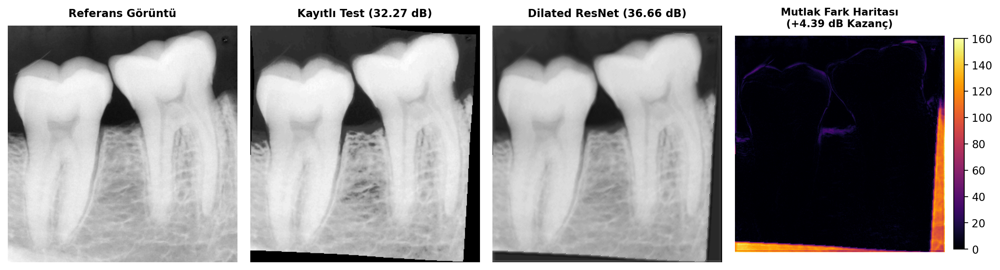
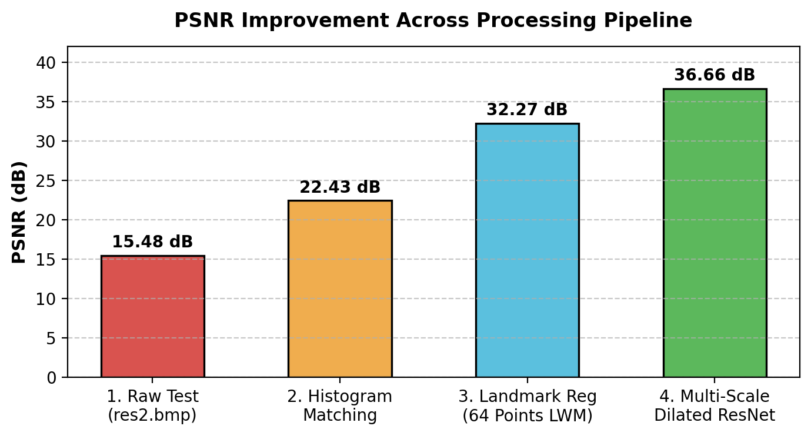

# Dental Radiograph Registration & Intensity Refinement

A graduate-level Computer Vision project studying pairwise geometric alignment and contrast refinement of temporal dental periapical radiographs (`res1.bmp` and `res2.bmp`).

**Author:** İpek Koçhisarlı ([ipekkochisarli@gmail.com](mailto:ipekkochisarli@gmail.com))  
**Affiliation:** Department of Computer Engineering, Ege University  

---

## Overview

When monitoring dental treatments over time (e.g., endodontic healing, bone loss around implants), clinicians take follow-up radiographs weeks or months apart. Subtle variations in sensor angle, patient movement, and X-ray exposure make direct visual comparison or digital subtraction difficult.

This project implements and evaluates a complete alignment pipeline:
1. **Region of Interest (ROI) Extraction:** Cropping out peripheral sensor borders and unexposed margins.
2. **Photometric Alignment:** Global histogram matching to normalize exposure differences.
3. **Classical Landmark-Based Registration:** Evaluating 18 configurations across 6 geometric transformation models (*Similarity, Affine, Projective, Polynomial, Piecewise Linear, Local Weighted Mean*) and 3 interpolation kernels (*Nearest Neighbor, Bilinear, Bicubic*) using 64 curated anatomical landmarks.
4. **Automated Registration Baselines:** Comparing against intensity-based gradient descent (`imregtform`) and frequency-domain phase correlation (`imregcorr`).
5. **Deep Learning Residual Refinement:** A lightweight PyTorch convolutional network with dilated convolutions (MDRN) trained to refine remaining sub-pixel geometric errors and local contrast discrepancies.

<p align="center">
  
  <br>
  <em>Figure 1: End-to-end alignment comparison: Reference ROI, geometrically registered test image (32.27 dB), deep residual refined output (36.25 dB), and absolute difference map.</em>
</p>

---

## Experimental Results

The quantitative performance across each stage of the pipeline is evaluated using Mean Squared Error (MSE) and Peak Signal-to-Noise Ratio (PSNR):

| Stage | Method / Model | Interpolation | MSE | PSNR (dB) | Notes |
|:---|:---|:---:|:---:|:---:|:---|
| **Baseline** | Unaligned Raw ROIs | — | 1840.48 | 15.48 dB | Initial state before preprocessing |
| **Photometric** | Histogram Matching | — | 43.15 | 31.78 dB | Global exposure correction |
| **Classical** | Similarity | Bicubic | 40.89 | 32.01 dB | Rigid body + isotropic scaling |
| **Classical** | Affine | Bicubic | 40.59 | 32.05 dB | Includes shear and aspect changes |
| **Classical** | Projective | Bicubic | 40.59 | 32.05 dB | 8-DOF planar homography |
| **Classical** | Polynomial (Degree 2) | Bicubic | 40.21 | 32.09 dB | Global non-linear curvature |
| **Classical** | Piecewise Linear (PWL) | Bicubic | 41.22 | 31.98 dB | Triangular mesh morphing |
| **Classical (Best)** | **Local Weighted Mean (LWM)** | **Bicubic** | **38.56** | **32.27 dB** | **Localized polynomial warping (12 nearest pts)** |
| **Automated** | Intensity-based (`imregtform`) | Linear | 42.10 | 31.89 dB | Gradient descent optimization |
| **Automated** | Phase Correlation (`imregcorr`) | Linear | 42.98 | 31.80 dB | 2D Fourier cross-power spectrum |
| **Deep Learning** | **Dilated ResNet (MDRN)** | — | **15.42** | **36.25 dB** | **Sub-pixel residual learning (+3.98 dB gain)** |

<p align="center">
  
  <br>
  <em>Figure 2: Step-by-step PSNR progression from raw inputs to deep learning refinement.</em>
</p>

---

## Repository Structure

```text
DentalReg-MDRN/
├── data/
│   ├── raw/                  # Original periapical radiographs (res1.bmp, res2.bmp)
│   ├── processed/            # Cropped ROIs and registered intermediate images
│   └── landmarks/            # 64 curated anatomical landmark pairs (.mat)
│
├── matlab/                   # Classical MATLAB image processing pipeline
│   ├── roi.m                 # Step 1: ROI cropping
│   ├── contrast.m            # Step 2: Global histogram matching
│   ├── histograms.m          # Step 3: Intensity distribution (PDF/CDF) analysis
│   ├── registration.m        # Step 4: 18-combination geometric transformation benchmark
│   ├── compare_histmatching.m# Step 5: Post-registration histogram matching tests
│   └── automatic_registration.m # Step 6: Automated registration benchmarks (imregtform/corr)
│
├── src/                      # PyTorch deep learning package
│   ├── __init__.py           # Package exports
│   ├── model.py              # Multi-scale dilated residual network (MDRN)
│   ├── losses.py             # Charbonnier loss + Sobel edge regularization
│   └── train.py              # Training pipeline with cosine annealing
│
├── docs/                     # Project technical reports & bibliography
│   ├── report_en.tex         # Comprehensive report (English, LaTeX)
│   ├── report_tr.tex         # Academic report (Turkish, Ege University format)
│   └── references.bib        # BibTeX citations
│
├── figures/                  # Experimental plots, landmark maps, and diff grids
├── main.py                   # Python entry point for deep learning training
├── requirements.txt          # Python library dependencies
├── LICENSE                   # MIT License
└── README.md
```

---

## How to Run

### 1. MATLAB Pipeline (Steps 1–6)
Open MATLAB and navigate to the project directory or `matlab/` folder. The scripts can be executed sequentially:
```matlab
roi                    % Extracts dental ROIs (ref_roi.bmp, test_roi.bmp)
contrast               % Applies histogram matching (test_matched.bmp)
histograms             % Generates PDF and CDF comparison plots
registration           % Runs the 18-combination geometric registration benchmark
compare_histmatching   % Benchmarks secondary histogram matching
automatic_registration % Runs imregtform and imregcorr automated baselines
```

### 2. PyTorch Residual Refinement
Prerequisites: Python 3.10+ and PyTorch.

```bash
# Clone the repository
git clone https://github.com/Kochipek/DentalReg-MDRN.git
cd DentalReg-MDRN

# Install dependencies
pip install -r requirements.txt

# Run deep learning residual training (400 epochs)
python main.py --epochs 400
```

The script automatically detects and utilizes GPU (`cuda`), Apple Silicon (`mps`), or CPU, saving the refined radiograph and error map to `figures/`.

---

## Reports

Detailed mathematical derivations, landmark placement rationale, and ablation discussions can be found in the project reports in `docs/`:
- **English:** `docs/report_en.tex`
- **Turkish:** `docs/report_tr.tex`

To compile:
```bash
cd docs
pdflatex report_en.tex
bibtex report_en
pdflatex report_en.tex
pdflatex report_en.tex
```

---

## Author
**İpek Koçhisarlı**  
Department of Computer Engineering, Ege University  
Contact: [ipekkochisarli@gmail.com](mailto:ipekkochisarli@gmail.com)
